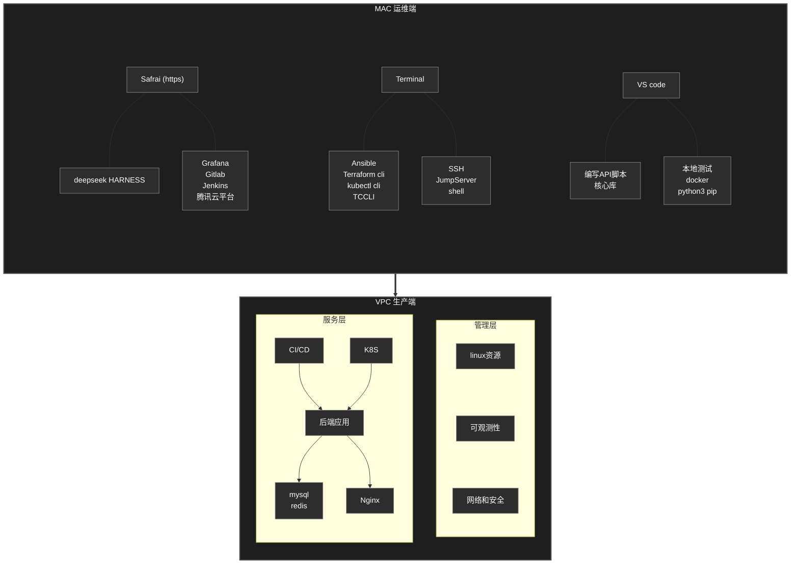

# Welcome to ZTI's CloudNative knowledge repository

> I'm still learning......
>

## Knowledge structure

```css
.
├── K8S
│   ├── 架构
│   │   ├── helm.md
│   │   ├── pod.md
│   │   ├── 存储.md
│   │   ├── 安全.md
│   │   ├── 网络.md
│   │   ├── 调度.md
│   │   ├── 集群.md
│   │   └── 控制器.md
│   ├── ArgoCD.md
│   ├── CKA.md
│   ├── Isito.md
│   ├── docker.md
│   └── 排障.md
├── LINUX
│   ├── SHELL
│   │   ├── SHELL.md
│   │   ├── 文件.md
│   │   └── 文本.md
│   ├── 本机
│   │   ├── 内核.md
│   │   ├── 安全.md
│   │   ├── 目录.md
│   │   ├── 管理.md
│   │   ├── 网络.md
│   │   ├── 资源.md
│   │   └── 配置.md
│   └── RHEL.md
├── PYTHON
│   ├── 库
│   │   ├── 1-CLI.md
│   │   ├── 1-日志.md
│   │   ├── 1-系统.md
│   │   ├── 2-HTTP.md
│   │   ├── 2-并发.md
│   │   ├── 2-配置文件.md
│   │   ├── SSH.md
│   │   ├── 云.md
│   │   ├── 数据.md
│   │   └── 测试.md
│   ├── 语言
│   │   ├── class.md
│   │   ├── data.md
│   │   ├── def.md
│   │   ├── error.md
│   │   ├── import.md
│   │   ├── logic.md
│   │   └── string.md
│   ├── API.md
│   ├── HTTP.md
│   ├── 工程.md
│   └── 并发.md
├── SEC
│   ├── network
│   │   └── network.md
│   └── safety
│       ├── CKS.md
│       └── safety.md
├── SRE
│   ├── CICD
│   │   ├── Ansible.md
│   │   ├── Jenkins.md
│   │   ├── Terraform.md
│   │   ├── git.md
│   │   ├── gitlab.md
│   │   ├── gitlabai大纲.md
│   │   └── tccli.md
│   └── SRE
│       ├── Observe1.md
│       ├── Observe2.md
│       ├── SRE.md
│       └── cloud.md
├── TOOL
│   ├── Mysql
│   │   ├── basis.md
│   │   ├── func.md
│   │   ├── jdbc.md
│   │   ├── lock.md
│   │   ├── sql.md
│   │   └── tools.md
│   ├── nginx.md
│   ├── redis.md
│   ├── 文件.md
│   └── 组件.md
└── README.md
```

## Technical architecture



## two big project:（两个大项目要有变化，整合不同技术栈，做一些创新）

基于 IaC 与 GitOps 的多环境云原生交付平台（自动化、工具链整合）：   

https://github.com/ZZZZTI/Cloud-Native-knowledge.git

核心链路 SLO 保障与全链路可观测性治理（稳定性、监控、应急响应）：

https://github.com/ZZZZTI/Cloud-Native-knowledge.git


## some small projects:

服务器变慢的全链路排查

MySQL 备份恢复演练

Helm chart 化三层应用

Ansible 标准化服务器初始化

Trivy 镜像漏洞扫描 + 修复闭环

......

https://github.com/ZZZZTI/Cloud-Native-knowledge.git


