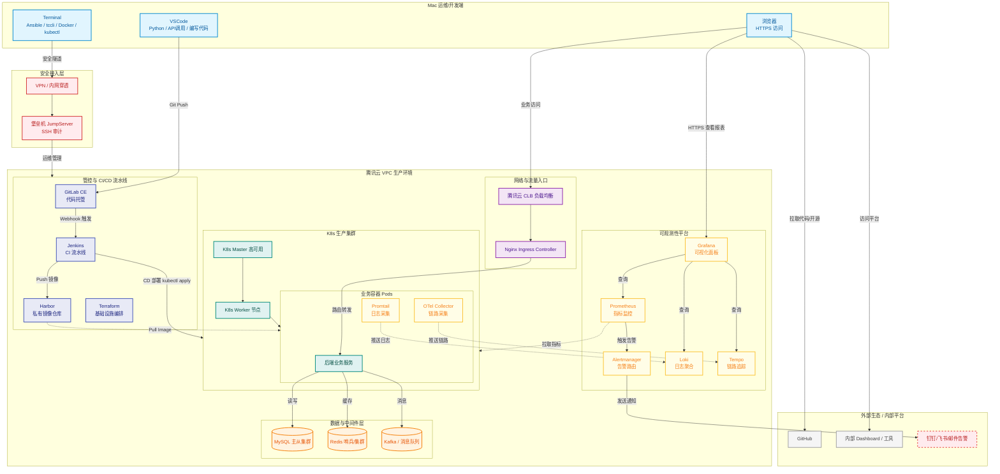

# Welcome to ZTI's CloudNative knowledge repository

> I'm still learning......
>

### Knowledge structure

```css
.
├── K8S
│   ├── 架构
│   │   ├── pod.md
│   │   ├── 存储.md
│   │   ├── 安全.md
│   │   ├── 网络.md
│   │   ├── 调度.md
│   │   ├── 包管理.md
│   │   └── 控制器.md
│   ├── ArgoCD.md
│   ├── CKAS.md
│   ├── docker.md
│   └── 排障.md
├── LINUX
│   ├── RHEL.md
│   ├── SHELL.md
│   ├── 内核.md
│   ├── 安全.md
│   ├── 文件.md
│   ├── 文本.md
│   ├── 目录.md
│   ├── 管理.md
│   ├── 网络.md
│   └── 资源.md
├── PYTHON
│   ├── 01-环境与运行.md
│   ├── 02-语言基础.md
│   ├── 03-字符串与正则.md
│   ├── 04-控制流.md
│   ├── 05-数据结构.md
│   ├── 06-函数.md
│   ├── 07-模块与包.md
│   ├── 08-文件与数据格式.md
│   ├── 09-异常与调试.md
│   ├── 10-面向对象.md
│   ├── 11-标准库运维常用.md
│   ├── 12-并发编程.md
│   ├── 13-网络与HTTP.md
│   ├── 14-gRPC与云原生.md
│   └── 15-可观测性与工程化.md
├── SEC
│   ├── network
│   │   └── network.md
│   └── safety
│       └── safety.md
├── SRE
│   ├── CICD
│   │   ├── Ansible.md
│   │   ├── Jenkins.md
│   │   ├── Terraform.md
│   │   ├── gh.md
│   │   └── git.md
│   └── SRE
│       ├── Observe1.md
│       ├── Observe2.md
│       ├── SRE.md
│       └── cloud.md
├── TOOL
│   ├── Mysql
│   │   ├── basis.md
│   │   ├── func.md
│   │   ├── jdbc.md
│   │   ├── lock.md
│   │   ├── sql.md
│   │   └── tools.md
│   ├── nginx.md
│   ├── redis.md
│   ├── 文件.md
│   └── 组件.md
└── README.md
```

### Technical architecture



### My projects:

基于 IaC 与 GitOps 的多环境交付流水线建设（自动化、工具链整合）：

https://github.com/ZZZZTI/Cloud-Native-knowledge.git

核心链路 SLO 保障与全链路可观测性治理（稳定性、监控、应急响应）：

https://github.com/ZZZZTI/Cloud-Native-knowledge.git


